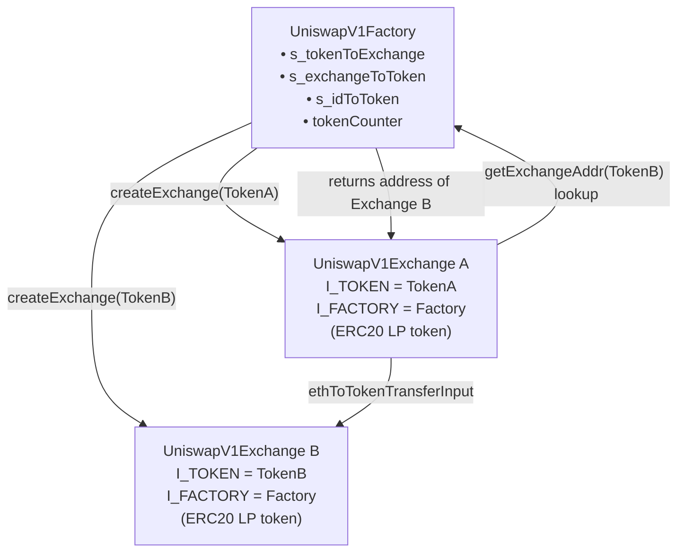

# Architecture

## Contracts

There are two contracts: `UniswapV1Factory` and `UniswapV1Exchange`.

**[UniswapV1Factory.sol](../../src/v1/UniswapV1Factory.sol)**

The factory is a registry. It keeps three mappings:

- `token → exchange` — look up an exchange by its token
- `exchange → token` — look up the token for an exchange
- `id → token` — enumerate exchanges by creation order (1-based)

It exposes one write function — `createExchange` — which deploys a new `UniswapV1Exchange` and registers it. Calling it twice with the same token reverts with `ExchangeAlreadyExists`.

**[UniswapV1Exchange.sol](../../src/v1/UniswapV1Exchange.sol)**

Each exchange is dedicated to a single ERC20 token paired with ETH. The exchange contract itself is the LP token — it inherits OpenZeppelin's `ERC20` and mints/burns shares as liquidity is added and removed.

Two immutable state variables are set at construction:

- `I_TOKEN` — the ERC20 token this exchange trades
- `I_FACTORY` — the factory address (used to look up sibling exchanges for token-to-token routing)

Reserves are not stored. The contract reads `address(this).balance` for ETH and `I_TOKEN.balanceOf(address(this))` for tokens on every call.

---

## Diagram

---

## Function Map

### UniswapV1Factory

| Function | Visibility | Description |
|---|---|---|
| `createExchange(token, name, symbol)` | `external` | Deploys a new exchange for the token |
| `getExchangeAddr(token)` | `external view` | Returns the exchange address for a token |
| `getTokenAddr(exchange)` | `external view` | Returns the token address for an exchange |
| `getTokenAddrWithId(id)` | `external view` | Returns the token registered at creation index `id` |

### UniswapV1Exchange — Liquidity

| Function | Visibility | Description |
|---|---|---|
| `addLiquidity(minLiquidity, maxTokens, deadline)` | `external payable` | Deposit ETH + tokens, receive LP tokens |
| `removeLiquidity(amount, minEth, minTokens, deadline)` | `external` | Burn LP tokens, withdraw ETH + tokens |

### UniswapV1Exchange — ETH-to-Token

| Function | Visibility | Description |
|---|---|---|
| `ethToTokenSwapInput(minTokens, deadline)` | `external payable` | Sell exact ETH, receive tokens to `msg.sender` |
| `ethToTokenSwapOutput(tokensBought, deadline)` | `external payable` | Buy exact tokens, refund excess ETH to `msg.sender` |
| `ethToTokenTransferInput(minTokens, deadline, recipient)` | `public payable` | Sell exact ETH, receive tokens to `recipient` |
| `ethToTokenTransferOutput(tokensBought, deadline, recipient)` | `public payable` | Buy exact tokens, send to `recipient` |

### UniswapV1Exchange — Token-to-ETH

| Function | Visibility | Description |
|---|---|---|
| `tokenToEthSwapInput(tokensSold, minEth, deadline)` | `external` | Sell exact tokens, receive ETH to `msg.sender` |
| `tokenToEthSwapOutput(ethBought, maxTokens, deadline)` | `external` | Buy exact ETH, sell tokens from `msg.sender` |
| `tokenToEthTransferInput(tokensSold, minEth, deadline, recipient)` | `public` | Sell exact tokens, receive ETH to `recipient` |
| `tokenToEthTransferOutput(ethBought, maxTokens, deadline, recipient)` | `public` | Buy exact ETH, send to `recipient` |

### UniswapV1Exchange — Token-to-Token (factory lookup)

| Function | Visibility | Description |
|---|---|---|
| `tokenToTokenSwapInput(tokensSold, minTokensBought, minEthBought, deadline, tokenAddress)` | `external` | Sell exact TokenA, receive TokenB to `msg.sender` |
| `tokenToTokenSwapOutput(tokensBought, maxTokensSold, maxEthSold, deadline, tokenAddress)` | `external` | Buy exact TokenB, sell TokenA from `msg.sender` |
| `tokenToTokenTransferInput(tokensSold, minTokensBought, minEthBought, deadline, recipient, tokenAddress)` | `external` | Sell exact TokenA, receive TokenB to `recipient` |
| `tokenToTokenTransferOutput(tokensBought, maxTokensSold, maxEthSold, deadline, recipient, tokenAddress)` | `public` | Buy exact TokenB, send to `recipient` |

### UniswapV1Exchange — Token-to-Token (direct exchange address)

| Function | Visibility | Description |
|---|---|---|
| `tokenToExchangeSwapInput(tokensSold, minTokensBought, minEthBought, deadline, exchangeAddress)` | `external` | Sell exact TokenA via direct exchange address |
| `tokenToExchangeSwapOutput(tokensBought, maxTokensSold, maxEthSold, deadline, exchangeAddress)` | `external` | Buy exact TokenB via direct exchange address |
| `tokenToExchangeTransferInput(tokensSold, minTokensBought, minEthBought, deadline, recipient, exchangeAddress)` | `public` | Sell exact TokenA, receive TokenB to `recipient` |
| `tokenToExchangeTransferOutput(tokensBought, maxTokensSold, maxEthSold, deadline, recipient, exchangeAddress)` | `public` | Buy exact TokenB, send to `recipient` |

### UniswapV1Exchange — Price Queries (view)

| Function | Description |
|---|---|
| `getInputPrice(inputAmount, inputReserve, outputReserve)` | Generic constant-product output calculation |
| `getOutputPrice(outputAmount, inputReserve, outputReserve)` | Generic constant-product input calculation |
| `getEthToTokenInputPrice(ethSold)` | How many tokens for a given ETH amount |
| `getEthToTokenOutputPrice(tokensBought)` | How much ETH to buy an exact token amount |
| `getTokenToEthInputPrice(tokensSold)` | How much ETH for a given token amount |
| `getTokenToEthOutputPrice(ethBought)` | How many tokens to buy an exact ETH amount |
