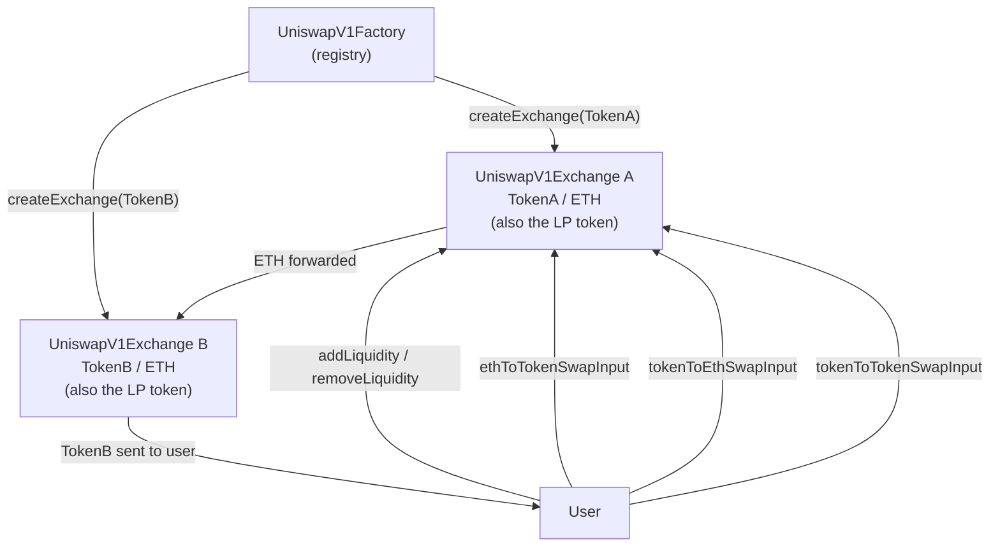
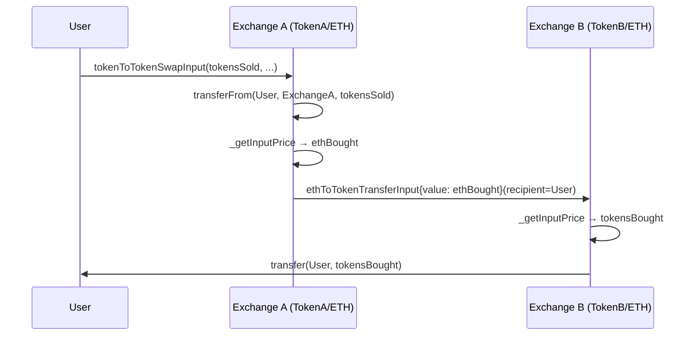

# Uniswap V1 — From Scratch

A full reimplementation of the Uniswap V1 protocol in Solidity, built with Foundry. This is part of my V1 → V2 → V3 learning series. The goal was to understand every design decision at the code level — from the constant-product AMM math, to how LP tokens work, to how token-to-token swaps route through ETH — by writing it myself rather than just reading about it.

For detailed documentation see [`docs/v1/`](../../docs/v1/README.md) (linked from the repo root).

---

## How It Works

### Factory and exchanges

`UniswapV1Factory` is a registry that maps each ERC20 token to a single exchange contract. You call `createExchange(token, name, symbol)` and it deploys a new `UniswapV1Exchange` for that token. Each token gets exactly one exchange — if you try to register the same token twice it reverts.

### The exchange is the LP token

`UniswapV1Exchange` inherits from OpenZeppelin's `ERC20`. The exchange contract _is_ the LP token. When you add liquidity you receive LP tokens minted to you. When you remove liquidity you burn them and get back your share of the pool.

### Reserves read from balances

There are no stored `ethReserve` or `tokenReserve` variables. The exchange reads reserves directly from `address(this).balance` (for ETH) and `I_TOKEN.balanceOf(address(this))` (for the paired token). This keeps things simple at the cost of being slightly easier to manipulate via forced ETH sends.

### The 0.3% fee

The fee is baked into the math as `997/1000`. Two constants — `FEE_MULTIPLIER = 997` and `FEE_DENOMINATOR = 1000` — are used inside `_getInputPrice` and `_getOutputPrice`. There is no separate fee accumulation; the fee stays in the pool and accrues to LPs as the reserves grow relative to outstanding LP tokens.

### Input vs Output, Swap vs Transfer

Every direction has four public entry points:

| Name pattern      | Meaning                                                                          |
| ----------------- | -------------------------------------------------------------------------------- |
| `*SwapInput`      | You specify exact tokens in, receive at least N tokens out, sent to `msg.sender` |
| `*SwapOutput`     | You specify exact tokens out, pay at most N tokens in, sent to `msg.sender`      |
| `*TransferInput`  | Same as SwapInput but output goes to a `_recipient` you specify                  |
| `*TransferOutput` | Same as SwapOutput but output goes to a `_recipient` you specify                 |

### Token-to-token routing through ETH

Every exchange only pairs its token with ETH. Token-to-token swaps are two hops: Token A → ETH on Exchange A, then ETH → Token B on Exchange B. This means token-to-token trades pay the 0.3% fee twice.

`tokenToTokenSwap*` variants look up the target exchange from the factory. `tokenToExchangeSwap*` variants take the exchange address directly, skipping the factory lookup.

### Architecture

### Token-to-token swap flow

---

## Tests & Coverage

**Test results:** 181 tests across 6 suites, 0 failed, 0 skipped.

| Suite                        | Tests   |
| ---------------------------- | ------- |
| `EthToTokenSwapUnitTest`     | 47      |
| `LiquidityProvidingUnitTest` | 33      |
| `TokenToEthSwapUnitTest`     | 43      |
| `TokenToTokenSwapUnitTest`   | 50      |
| `UniswapV1ExchangeUnitTest`  | 5       |
| `UniswapV1FactoryUnitTest`   | 3       |
| **Total**                    | **181** |

**Coverage:** 100% lines, statements, branches, and functions across both contracts.

| File                    | Lines          | Statements     | Branches     | Functions    |
| ----------------------- | -------------- | -------------- | ------------ | ------------ |
| `UniswapV1Exchange.sol` | 100% (261/261) | 100% (308/308) | 100% (61/61) | 100% (36/36) |
| `UniswapV1Factory.sol`  | 100% (18/18)   | 100% (15/15)   | 100% (2/2)   | 100% (4/4)   |
| **Total**               | **100%**       | **100%**       | **100%**     | **100%**     |

> **Note:** `foundry.toml` sets `via_ir = true`. This is required because `_tokenToTokenInput` and `_tokenToTokenOutput` are 7-parameter private functions and the compiler hits "Stack too deep" without IR optimization.

---

## Limitations and Security Notes

> This is a learning project. It has not been audited. Do not use it with real funds.

**Reentrancy risk in token-to-ETH functions.** In both `_tokenToEthInput` and `_tokenToEthOutput`, the ETH is sent to the recipient _before_ `I_TOKEN.transferFrom(...)` pulls the tokens in from the buyer. This is the same order as the original Uniswap V1 Vyper implementation, but by modern Solidity standards it is a reentrancy risk. The exchange has no reentrancy guard.

**No SafeERC20.** Token transfers use raw `IERC20.transfer` and `transferFrom` and check the returned bool. Non-standard ERC-20 tokens that don't return a bool (e.g. USDT on mainnet) would cause transfers to always revert, or silently succeed if the return value check is skipped. OpenZeppelin's `SafeERC20` handles these edge cases; this implementation does not.

**Double fee on token-to-token swaps.** Because every exchange only pairs with ETH, a token-to-token swap routes through two exchanges and pays the 0.3% fee twice. A direct token-to-token pool (like in V2) would pay it only once.

**Unit tests only.** There are no fuzz tests, invariant tests, or integration tests. The unit tests were AI-assisted and reviewed by me.

---

## Credits

- Original Uniswap V1 contracts (Vyper): [github.com/Uniswap/v1-contracts](https://github.com/Uniswap/v1-contracts) and the [V1 whitepaper](https://hackmd.io/@HaydenAdams/HJ9jLsfTz)
- Solidity/Foundry reference I followed while building: [github.com/rosarioborgesi/uniswap-v1-from-scratch](https://github.com/rosarioborgesi/uniswap-v1-from-scratch) (his repo also has fuzz and invariant tests, which this repo doesn't)
- Unit tests were AI-assisted and reviewed by me.
